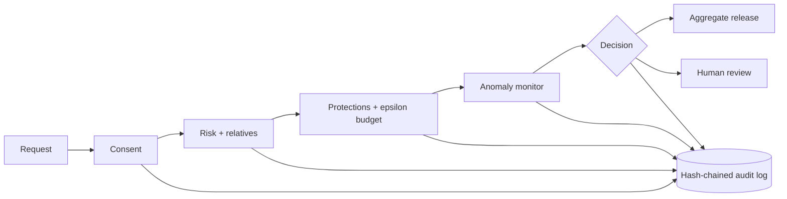

# GenomeGuard

> Genomic data can expose your relatives, so we built a guard that decides who can see what,
> explains why, and proves it never looked the other way.

GenomeGuard is a consent-aware, relative-aware governance and security layer in front of a
genomic data store. Every data request is checked against donor consent, scored for
re-identification risk (including the risk to donors' **relatives**), protected when needed,
monitored for attack patterns, and written to a tamper-evident audit log. Agents explain
decisions in plain language but never see genomic data and never hold final authority.

**Hackathon track: Track 2, Agentic AI for Healthcare.** GenomeGuard covers all four themes:

| Track 2 theme | Where it shows up |
|---|---|
| Decision support | Agents give stewards a case summary and the questions to answer on held requests; a human approves or denies. |
| Information management | Consent, risk, privacy budget and a tamper-evident audit chain for every genomic release. |
| Patient interaction | The patient portal: donors see who used statistics that included them, ask a consent concierge (fixed questions only) and withdraw in two clicks. |
| Workflow automation | Requests are triaged automatically: approve, approve with protections, deny, or hold for review. Anomalous accounts are frozen. |

"Agents advise, rules decide": the agents never see genotypes and never hold final authority.

**Data statement: all data in this repository is synthetic.** An optional path builds a cohort
from real, openly released 1000 Genomes genotypes (see below); consent records are always
simulated. Designed around the ideas of DPDP, GDPR and HIPAA. **It makes no claim of legal
compliance.**

## Run it

```
make setup && make seed && make test && make eval && make run     # then open http://localhost:8000
make demo                                                        # scripted 3-minute scenario, checked
```
No API key is needed. With `ANTHROPIC_API_KEY` set, agents write the explanations; without it,
deterministic templates do. Docker: `docker compose up --build`.

Demo accounts and the steward key are published at `/demo/requesters` (demo mode, synthetic data
only). Use the "Acting as" selector in the app to switch roles.

## What is real and what is simulated

| Part | Status |
|---|---|
| AES-256-GCM encryption at rest, per-dataset keys | Real, tested |
| Hash-chained audit log and tamper detection | Real, tested |
| Differential privacy (Laplace) and epsilon ledger | Real mechanism, simplified accounting |
| Secure aggregation across sites | Real protocol, runs in one process here |
| Attack evaluation (`make eval`) | Real attacks, run on the cohort loaded |
| Agents | Real; deterministic templates by default, an LLM when `ANTHROPIC_API_KEY` is set |
| Genotypes | Synthetic by default; real 1000 Genomes with `make fetch-real` (run on your machine) |
| Donor consent and requesters | Simulated. No real people consented to this system, so inventing "real" consent would be false |
| Relatives | Simulated kinship model unless you load real trios |

## What it does



- **Beacon v2 style endpoint** (`GET /beacon/g_variants?referenceName=&start=&alternateBases=`): an interoperable yes/no or count lookup that is governed by the same consent, risk, privacy budget and anomaly checks as every other request. It follows the GA4GH Beacon v2 response shape but is not a certified Beacon.
- **Homomorphic encryption**: `core/paillier.py` is a real Paillier implementation (stdlib only). Hospitals encrypt allele counts, an aggregator adds ciphertexts, and only the total is decrypted (`GET /federated/he`, Federated page). Educational and unaudited; secure enclaves are not implemented.
- **Consent engine** (DUO-inspired): withdrawal, general / health / disease-specific use,
  no-commercial, no-methods, no-aggregate, no-controls, population limits. Reports how many donors
  were excluded and why, never who.
- **Risk estimator:** uniqueness and information bits for record-level releases; rare-variant
  carriers and a membership-inference signal for aggregates; **relative exposure** from a family
  graph (a simulated model using expected-average kinship, not a forecast about any real database).
- **Protections:** drop rare variants, bin, cap variant count, Laplace noise within a per-requester
  epsilon budget; escalate to a human rather than auto-release when risk stays high.
- **Anomaly monitor:** rate, near-duplicate probing, cohort narrowing, a **differencing guard**,
  cumulative exposure; ok, warn, throttle, freeze; human unfreeze.
- **Audit log:** SHA-256 hash chain, verification, tamper demo, external anchor.
- **Encryption at rest:** AES-256-GCM, key per dataset, bound to dataset and donor.
- **Federated secure aggregation:** simulated hospitals compute frequencies and train a model
  without pooling rows.
- **Agents:** advisory, sanitized, with deterministic fallback. Decisions come from code.

## Measured results (`make eval`, fixed seeds, synthetic data)

| Test | Result |
|---|---|
| Tracker (differencing) attack | 100% recovery with no defence; **54.3%** with the guard, equal to the 54.3% guessing baseline |
| Membership inference, 100 variants | AUC 0.72 raw; about 0.50 at epsilon 0.5, where correlation with the true frequencies falls to 0.04 |
| Triangulation by narrow queries | Frozen in 100% of trials at gaps up to 120 s, median 8 to 10 queries; **not** caught at 600 s gaps |
| 500 simulated researcher sessions | 0.0% flagged (95% CI up to 0.8%); 0.4% of queries refused |

Full tables, the privacy-versus-utility curve and a plain list of **what the evaluation does not
show**: [`docs/eval-results.md`](docs/eval-results.md).

## Real data (optional, run on your own machine)

```
make fetch-real            # downloads 1000 Genomes chr22, builds data_real/1000g_chr22.npz
GG_REAL_COHORT_FILE=data_real/1000g_chr22.npz make seed && make run
make fetch-duo             # official DUO terms vs the rules this engine implements
```
Real: genotypes, frequencies, population labels, parent/child links in the pedigree file.
Simulated: consent. The Phase 3 release is built from deliberately unrelated people, so family
exposure is sparse; for real families use the high-coverage release with 602 trios (pass `--vcf`
and `--ped`). Check IGSR's data-use terms and never commit downloaded data.

## Limitations

Synthetic data; simplified attacks written by the defenders; simple epsilon accounting (not a
formal DP accountant); the hash chain detects tampering but cannot prevent it unless the head hash
is anchored outside the system; slow probing beyond the 15-minute window evades the rate-based
detectors; secure aggregation assumes honest-but-curious sites; no homomorphic encryption, secure
enclave or real consent-management integration; no independent security review. Details in
[`docs/threat-model.md`](docs/threat-model.md).

## Repository map

`backend/app/core/` rules and math | `backend/app/agents/` advisory agents | `backend/app/data/`
generators and real-data loaders | `backend/redteam/` attacks and evaluation | `frontend/` UI |
`docs/` architecture, threat model, eval, demo script, slide inputs | `scripts/demo.py`.

## References

- Erlich et al., "Identity inference of genomic data using long-range familial searches", *Science* 2018.
- Shringarpure and Bustamante, "Privacy risks from genomic data-sharing beacons", *Am. J. Hum. Genet.* 2015.
- Update-flip attack on beacons: arXiv:2001.08852. Differential privacy for GWAS statistics: arXiv:1205.0739.
- GA4GH Beacon v2; GA4GH Data Use Ontology (DUO), https://github.com/EBISPOT/DUO (CC BY 4.0).
- 1000 Genomes Project / IGSR; Byrska-Bishop et al., high-coverage 1000 Genomes cohort including 602 trios, *Cell* 2022.

## Audit anchor

Copy the current head hash from the Audit page into this section after a final run, so a rewritten
history no longer matches: `head hash: (not yet published)`.

MIT licence.
