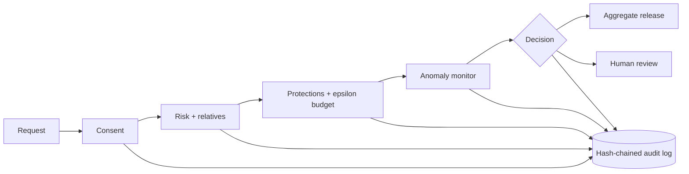

# GenomeGuard

**A governance layer that sits in front of a genomic data store and decides who may see what.**
Every request is checked against donor consent, scored for re-identification risk (including the
risk to donors' *relatives*), protected when needed, watched for probing attacks, and written to a
tamper-evident audit log. AI agents explain each decision in plain language, but fixed rules make
it, and a person signs off on anything risky.

[](https://github.com/kaustubhdua/GenomeGuard/actions/workflows/ci.yml)


> **Status: research prototype.** Runs on synthetic data by default, with consent and requesters
> simulated. It has had no independent security review and makes no claim of legal compliance
> (it is designed around the ideas of DPDP, GDPR and HIPAA). Do not use it with real participant data.

## Why

Genomes are shared by families. A rare variant released about one person can point at a sibling or
a parent who never agreed to anything, and a series of slightly different "harmless" statistics can
isolate one individual. Consent tooling, privacy maths and audit trails usually live in different
places. GenomeGuard puts them in one decision path and records every step.

## What it does



- **Consent engine** (inspired by GA4GH DUO): withdrawal, general, health and disease-specific use,
  no-commercial, population limits. Reports how many donors were excluded and why, never who.
- **Risk estimator:** uniqueness, rare-variant carriers, a membership-inference signal, and
  **relative exposure** from a family graph (a model built on expected kinship, not a forecast).
- **Protections:** drop rare variants, bin, cap variant count, Laplace noise within a per-requester
  epsilon budget, or escalate to a human instead of releasing.
- **Anomaly monitor:** rate, near-duplicate probing, cohort narrowing and a differencing guard;
  warn, throttle, freeze, with a human unfreeze.
- **Steward copilot:** a read-only, tool-using agent that gathers evidence and recommends. A rules
  baseline caps it, so it can never be more permissive than the rules.
- **Audit log:** SHA-256 hash chain with verification and an external anchor.
- **Patient portal:** donors see who used statistics that included them, change or withdraw
  consent, and download it as a FHIR R4 Consent resource.
- **Interop and crypto demos:** a GA4GH Beacon v2 style endpoint under the same checks, Paillier
  homomorphic aggregation, and secure aggregation across simulated sites.
- **Encryption at rest:** AES-256-GCM, one key per dataset.

The web UI has nine pages: Overview, Requests, Decision detail, Family exposure, Anomalies, Audit
log, Patient view, Red-team results and Federated analysis. Light and dark themes, keyboard
navigation, and a 3-minute guided tour that performs the real actions.

## Quick start

```
make setup            # virtualenv and dependencies (Python 3.11+)
make seed && make run # then open http://localhost:8000
```

Or with Docker: `docker compose up --build`. No API key is needed. If `ANTHROPIC_API_KEY` is set,
agents write the explanations with a model; otherwise deterministic templates do. In the default
demo mode the app publishes demo accounts at `/demo/requesters`, and the "Acting as" selector
switches between researcher, steward and patient.

Other commands:

```
make test lint        # backend tests and ruff
make eval             # red-team evaluation, fixed seeds, regenerates docs/eval-results.md
make demo             # scripted end-to-end scenario against a throwaway server
make bench            # latency and audit-cost numbers (docs/scalability.md)
make ui-smoke         # headless-browser checks: contrast, accessibility, phone widths, the tour
make deploy-smoke URL=https://your-service.onrender.com   # read-only check of a deployment
```

## What is real and what is simulated

| Part | Status |
|---|---|
| AES-256-GCM encryption at rest, hash-chained audit log, tamper detection | Real, tested |
| Differential privacy (Laplace) and epsilon ledger | Real mechanism, simplified accounting |
| Attack evaluation | Real attacks written by the same authors as the defences, run on the loaded cohort |
| Agents and steward copilot | Real tool loop; templates by default, a model when a key is set; they never see genotypes |
| Genotypes | Synthetic by default. Optionally real 1000 Genomes data (below) |
| Relatives | A kinship model by default; real pedigree links when you load a family cohort |
| FHIR R4 Consent export | Valid structure (checked with the HL7 validator), built from simulated consent. Not legal consent |
| Donor consent, requesters, query traffic | **Simulated.** No real person consented to this system |

## Measured results

From `make eval` (fixed seeds, synthetic data). Full tables and a list of what the evaluation does
not show are in [`docs/eval-results.md`](docs/eval-results.md).

| Test | Result |
|---|---|
| Tracker (differencing) attack | 100% recovery with no defence; 54.3% with the guard, equal to the guessing baseline |
| Membership inference, 100 variants | AUC 0.72 raw; about 0.50 at epsilon 0.5, where noise also destroys most of the signal |
| Triangulation by narrow queries | Frozen in 100% of trials at gaps up to 120 s; **not** caught at 600 s gaps |
| 500 simulated researcher sessions | 0.0% flagged (95% CI up to 0.8%); 0.4% of queries refused |

Performance on a 2 vCPU machine: about 30 requests per second, median 33 ms per decision
([`docs/scalability.md`](docs/scalability.md)).

## Using real genomes (optional)

```
make fetch-real                                    # 1000 Genomes Phase 3, chr22
GG_REAL_COHORT_FILE=data_real/1000g_chr22.npz make seed && make run
make real-trios VCF=<chr22.vcf.gz> PED=<pedigree>  # high-coverage release: real parent/child links
make eval-real COHORT=data_real/1000g_trios.npz    # evaluation on that cohort
```

A dataset is labelled real only if the cohort file's own metadata says so, and the UI shows its
provenance on every page. Check IGSR's data-use terms and never commit downloaded data. Details,
file hashes and CI evidence: [`docs/real-data.md`](docs/real-data.md).

## Deploying

The Docker image and `render.yaml` run the synthetic demo. With `GG_DEMO_MODE=false` the server
refuses to start unless the admin key and master key are strong and the tamper exercise is off.
See [`docs/configuration.md`](docs/configuration.md) and [`SECURITY.md`](SECURITY.md).
[](https://render.com/deploy?repo=https://github.com/kaustubhdua/GenomeGuard)
This opens Render's Blueprint flow and does not mean a public instance exists. Free instances sleep
when idle and lose local data on restart.

## Limitations

Simplified epsilon accounting (not a formal accountant); a hash chain detects tampering but cannot
prevent it unless the head hash is kept outside the system; slow probing beyond the 15-minute window
evades the rate-based detectors; the Paillier and secure-aggregation modules are educational and
run in one process; SQLite and in-process state limit it to one writer; no real identity or
consent-management integration; no independent security review. See
[`docs/threat-model.md`](docs/threat-model.md).

## Documentation

| | |
|---|---|
| [Architecture](docs/architecture.md) | Pipeline, modules, what a researcher can and cannot see |
| [Threat model](docs/threat-model.md) | Attacks considered, defences, residual risk |
| [HTTP API](docs/api.md) | Every endpoint and who may call it |
| [Configuration](docs/configuration.md) | Environment variables |
| [Walkthrough](docs/walkthrough.md) | A three-minute guided tour of the product |
| [Evaluation](docs/eval-results.md) | Red-team results and limits |
| [Scalability](docs/scalability.md) | Measured numbers and what would change at scale |
| [Consent policy](docs/consent-policy.md) | How consent terms are interpreted |
| [Real data](docs/real-data.md) | Building a cohort from 1000 Genomes |
| [Verification](docs/verification.md) | CI runs and validations behind the claims above |
| [Hackathon materials](docs/hackathon/README.md) | Submission aids for Tech Eximius 2.0 (not needed to run the project) |

## Repository layout

`backend/app/core/` rules and maths | `backend/app/agents/` advisory agents | `backend/app/data/`
generators and loaders | `backend/redteam/` attacks and evaluation | `frontend/` UI (plain ES
modules, no build step) | `fhir/` FHIR extension package | `scripts/` demo, benchmark, smoke tests.
Contributions: [`CONTRIBUTING.md`](CONTRIBUTING.md). Changes: [`CHANGELOG.md`](CHANGELOG.md).

## References

- Erlich et al., "Identity inference of genomic data using long-range familial searches", *Science* 2018.
- Shringarpure and Bustamante, "Privacy risks from genomic data-sharing beacons", *Am. J. Hum. Genet.* 2015.
- Update-flip attack on beacons: arXiv:2001.08852. Differential privacy for GWAS statistics: arXiv:1205.0739.
- GA4GH Beacon v2; GA4GH Data Use Ontology, https://github.com/EBISPOT/DUO (CC BY 4.0).
- 1000 Genomes Project / IGSR; Byrska-Bishop et al., high-coverage cohort with 602 trios, *Cell* 2022.

## Licence

MIT. See [`LICENSE`](LICENSE).
