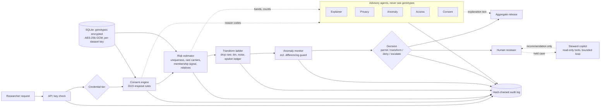

# Architecture

GenomeGuard sits in front of a genomic data store. A request never touches genotypes directly: it
passes a fixed pipeline, and only an aggregate or transformed release comes out.

## The decision is deterministic; agents advise

`app/service.py` (`GenomeGuardService`) runs the pipeline and **makes every decision**. The agents
(`app/agents/`) turn the numbers into plain language and give advisory opinions (the privacy agent
can note whether it agrees with the ladder; the access agent summarises requester history). They:

- receive only what `agents/sanitizer.py` lets through: counts, bands, reason codes, epsilon
  values, outcomes. Not genotypes, donor ids, family ids, cohort membership or free text. A test
  plants a canary string in all of those and asserts it never appears in a prompt.
- never hold authority. An LLM-only gate could be talked into releasing data by a crafted request;
  a deterministic gate cannot.
- fall back to templates (`agents/templates.py`) when there is no API key, so the demo never fails.
- have their outputs written to the audit chain with the model name and a hash of the prompt.

### The steward copilot (the one agent that chooses what to do next)

`agents/copilot.py` investigates a held or flagged request for a human steward. Unlike the other
agents it is a loop: it picks a tool, reads the result, and decides whether to pick another or to
recommend `approve`, `deny` or `more_info`. Its guardrails are code, not instructions to a model:

- **Read-only by construction.** It is built from a dict of zero-argument read functions and is
  never given the service object, so it has no way to approve, deny, freeze, release or edit. A
  test inspects its source for any write call and rejects unknown (write-like) tool names.
- **Sanitised.** Every tool result passes through the same `sanitize()` whitelist as the other
  agents before it is stored or shown to a model. Planted canary strings and instruction text in
  tool output never reach a prompt (tested).
- **Bounded.** At most 6 tool calls, each tool once, and it refuses to advise before reading the
  basics (case, consent, risk).
- **Never more permissive than the rules.** A deterministic rule set computes a baseline
  recommendation from the same evidence. If a model recommends something more permissive, its
  answer is discarded and the rules' answer is used. A model can add caution, never remove it.
- **Grounded.** Numbers in a model's rationale must appear in the evidence, or the rationale is
  replaced by the deterministic one.
- **Works with no key.** A deterministic planner chooses the tools and the rules write the text.
- **Audited.** Each tool call and the final recommendation are written to the hash chain with the
  model name and prompt hashes. Endpoint: `POST /requests/{id}/copilot` (steward only).

## Modules

| Module | Job |
|---|---|
| `core/consent.py` | Rules: withdrawal, GRU/HMB/DS, NCU/NPU/NMDS/NAGR/NCTRL, population. First failing rule wins, so reasons are deterministic. Returns counts, never donor ids. |
| `core/risk.py` | Scores a candidate release. Record level: uniqueness and information bits. Aggregate level: rare-variant carriers and a membership-inference signal. Always: relative exposure (simulated model). |
| `core/transform.py` | Ladder: drop rare variants, record to count, bin, cap variants, Laplace noise, last-resort boolean. Re-scores after each step, stops when risk is low. Epsilon ledger per requester per dataset. |
| `core/anomaly.py` | Rate, near-duplicate probing, cohort narrowing, differencing guard, cumulative exposure. Weighted score to ok, warn, throttle, freeze. |
| `core/audit_chain.py` | `hash = SHA256(canonical_json({idx, ts, actor, action, payload, prev_hash}))`. `verify()` returns `{ok, length, head_hash, first_broken_index}`. |
| `core/crypto.py` | AES-256-GCM at rest, key per dataset derived from a master key with HKDF, ciphertext bound to dataset and donor id. |
| `agents/copilot.py` | The steward copilot described above: tool loop, rules baseline, safety caps. |
| `core/federated.py` | Secure aggregation by additive secret sharing; federated allele frequencies and logistic regression across simulated hospitals. |
| `data/synth.py`, `data/pedigree.py` | Synthetic cohort with real Mendelian transmission and a derived relationship graph. |
| `data/real.py`, `data/duo.py` | Optional: build a cohort from real 1000 Genomes files; compare our rules with the official DUO. |
| `service.py`, `api.py`, `store.py` | Orchestration, Starlette HTTP layer, SQLite store. Also the FHIR R4 `Consent` export (`GET /donor/{id}/consent.fhir.json`, pseudonymous, tagged simulated). |
| `frontend/` | Vanilla JS, no build step. `tour.js` is a guided tour whose two action steps call the real API. |
| `scripts/` | `demo.py` (scripted scenario), `bench.py` (measured throughput), `ui_smoke.py` (headless-browser regression test: contrast, names, overflow, tour). |
| `redteam/` | Attacks, benign traffic and the evaluation behind `make eval`. |

## Tiers and levels

Credential tiers mirror GA4GH Beacon v2: `anonymous` (boolean or count only, and only for cohorts of at least 5 x `k_min` = 100),
`registered` (frequencies), `controlled` (may ask for record level, which always needs a human).
Data levels run coarse to fine: boolean, count, frequency, record.

## What a researcher can and cannot see

Responses contain aggregates, transformed releases, counts and reason codes. Steward-only detail
(`min_carriers`, family exposure, detector scores, advisory notes) is removed from researcher
responses, because it describes withheld variants and would let an attacker tune queries to stay
under thresholds. See `requester_view` in `app/api.py`.

## Scaling, honestly

- **Fine as built:** one dataset of thousands of donors; per-request cost is a few numpy
  operations over the eligible cohort.
- **Would change first:** SQLite to Postgres (the store is one small class); the in-memory
  `Dataset` to a column store or memory-mapped array when the genotype matrix exceeds RAM; the
  anomaly monitor's in-process windows to Redis so several API replicas share state; a job queue
  for large requests; a KMS/HSM for the master key.
- **Not solved here:** the audit chain is single-writer. Multi-writer needs consensus or a
  transparency-log service.
