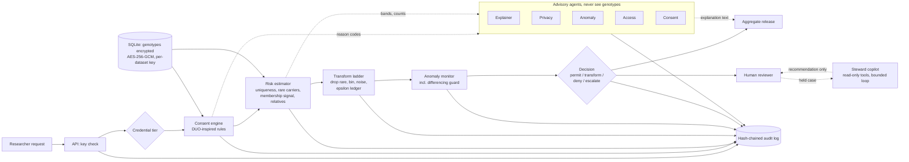

# Architecture

GenomeGuard sits in front of a genomic data store. A request never touches genotypes directly: it
passes a fixed pipeline, and only an aggregate or transformed release comes out.

## The decision is deterministic; agents advise

`app/service.py` (`GenomeGuardService`) runs the pipeline and **makes every decision**. The agents
(`app/agents/`) turn the numbers into plain language and give advisory opinions. They:

- receive only what `agents/sanitizer.py` lets through: counts, bands, reason codes, epsilon
  values, and outcomes. Not genotypes, donor IDs, family IDs, cohort membership, or free text.
  Tests plant canary strings in sensitive fields and assert that they do not reach agent input.
- never hold authority. An agent cannot approve a request or override the deterministic policy
  engine; the release decision is made by code.
- run offline. The current `agents/llm.py` is a compatibility facade that deliberately ignores
  provider credentials and transports and always reports the hosted LLM unavailable. There are
  no outbound AI-provider requests. Explanations use deterministic templates and the steward
  copilot uses its bounded local rules planner.
- record advisory output and evidence metadata in the audit chain; this is not an external,
  independently anchored audit service.

### The steward copilot (deterministic investigation assistant)

`agents/copilot.py` investigates a held or flagged request for a human steward. It is a bounded
rules-based loop: it picks a read-only tool, reads the result, and may recommend
`approve`, `deny`, or `more_info`. Its guardrails are code:

- **Read-only by construction.** It receives a dictionary of zero-argument read functions, not the
  service object, so it cannot approve, deny, freeze, release, or edit.
- **Sanitised.** Tool results pass through the same `sanitize()` whitelist before being stored
  or shown. Sensitive canary strings and instruction text in tool output are tested.
- **Bounded.** At most six tool calls, each tool once, and it refuses to advise before reading
  the basic case, consent, and risk evidence.
- **No policy override.** A deterministic rule set computes the baseline recommendation. The
  copilot cannot recommend a more permissive outcome than that baseline.
- **Grounded.** Any numeric rationale must be present in the evidence or is replaced by the
  deterministic explanation.
- **Offline.** No model provider, API key, network connection, or remote inference is involved.
- **Audited.** Tool calls and recommendations are written to the local hash chain. Endpoint:
  `POST /requests/{id}/copilot` (steward only).

## Audit checkpoint trust boundary

Audit checkpoints contain an unkeyed SHA-256 digest. The `signed_by` field is an attribution label only; it is not a cryptographic signature and does not authenticate the publisher. Verification checks structure, digest consistency, and the checkpointed audit-chain prefix. For authenticity and truncation resistance, export checkpoints to an independently controlled, authenticated system or have a separately managed signing service sign and retain them. Do not rely on a checkpoint stored only beside the database it is meant to protect.

## Modules

| Module | Job |
|---|---|
| `core/consent.py` | Rules: withdrawal, GRU/HMB/DS, NCU/NPU/NMDS/NAGR/NCTRL, population. First failing rule wins, so reasons are deterministic. Returns counts, never donor ids. |
| `core/risk.py` | Scores a candidate release. Record level: uniqueness and information bits. Aggregate level: rare-variant carriers and a membership-inference signal. Always: relative exposure (simulated model). |
| `core/transform.py` | Ladder: drop rare variants, record to count, bin, cap variants, Laplace noise, last-resort boolean. Re-scores after each step, stops when risk is low. Epsilon ledger per requester per dataset. |
| `core/anomaly.py` | Rate, near-duplicate probing, cohort narrowing, differencing guard, cumulative exposure. Weighted score to ok, warn, throttle, freeze. |
| `core/audit_chain.py` | `hash = SHA256(canonical_json({idx, ts, actor, action, payload, prev_hash}))`. `verify()` returns `{ok, length, head_hash, first_broken_index}`. |
| `core/crypto.py` | AES-256-GCM protects selected encrypted application records; keys are derived per dataset with HKDF and ciphertext is bound to dataset and donor id. The public reference cohort artifact is plaintext in the container image, so this deployment is not suitable for private or controlled-access data. |
| `agents/copilot.py` | The steward copilot described above: tool loop, rules baseline, safety caps. |
| `core/federated.py` | Secure aggregation by additive secret sharing; federated allele frequencies and logistic regression across simulated hospitals. |
| `data/synth.py`, `data/pedigree.py` | Synthetic cohort with real Mendelian transmission and a derived relationship graph. |
| `data/real.py`, `data/duo.py` | Optional: build a cohort from real 1000 Genomes files; compare our rules with the official DUO. |
| `data/vcf_import.py`, `data/vcf_qc.py` | Shared constrained VCF parser, provenance-gated normalized import, and aggregate-only local or temporary steward QC. |
| `service.py`, `api.py`, `store.py` | Orchestration, Starlette HTTP layer, SQLite store. Also the FHIR R4 `Consent` export (`GET /donor/{id}/consent.fhir.json`, pseudonymous, tagged simulated). |
| `frontend/` | Vanilla JS, no build step. `tour.js` is a guided tour whose two action steps call the real API. |
| `scripts/` | `demo.py` (scripted scenario), `bench.py` (measured throughput), `ui_smoke.py` (headless-browser regression test: contrast, names, overflow, tour). |
| `redteam/` | Attacks, benign traffic and the evaluation behind `make eval`. |

### VCF QC trust boundary

The standalone QC CLI reads a local VCF without database access. The Dataset QC
browser's JSON preview is also local, but its VCF upload sends raw bytes to the
configured GenomeGuard backend at `POST /admin/vcf-qc`. That route is steward-only,
applies explicit size/processing limits, stages data in a temporary directory, returns
aggregate metrics, and does not import or persist the source VCF. It is not a
third-party analysis service; deployment operators still control where the file is
transmitted and processed. Neither successful parsing nor an assembly label proves
source authorization, reference-sequence identity, consent, or import eligibility.

## Tiers and levels

Credential tiers mirror GA4GH Beacon v2: `anonymous` (boolean or count only, and only for cohorts of at least 5 x `k_min` = 100),
`registered` (frequencies), `controlled` (may ask for record level, which always needs a human).
Data levels run coarse to fine: boolean, count, frequency, record.

## What a researcher can and cannot see

Responses contain aggregates, transformed releases, counts and reason codes. Steward-only detail
(`min_carriers`, family exposure, detector scores, advisory notes) is removed from researcher
responses, because it describes withheld variants and would let an attacker tune queries to stay
under thresholds. See `requester_view` in `app/api.py`.

## Scaling, honestly

- **Fine as built:** one dataset of thousands of donors; per-request cost is a few numpy
  operations over the eligible cohort.
- **Would change first:** SQLite to Postgres (the store is one small class); the in-memory
  `Dataset` to a column store or memory-mapped array when the genotype matrix exceeds RAM; the
  anomaly monitor's in-process windows to Redis so several API replicas share state; a job queue
  for large requests; a KMS/HSM for the master key.
- **Not solved here:** the audit chain is single-writer. Multi-writer needs consensus or a
  transparency-log service.
