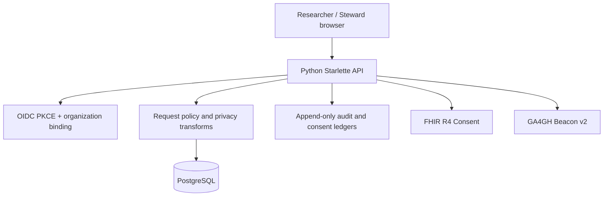

# GenomeGuard — hackathon demo and submission guide

Updated: 10 November 2026

## One-line pitch

**GenomeGuard is a research-governance workbench for genomic data.** It connects institutional identity, organization-scoped access, consent evidence, privacy-aware research requests, steward decisions, provenance, and append-only audit trails in one demonstrable workflow.

The live submission environment is synthetic-only:

- App: https://genomeguard-staging-pr113.onrender.com
- Health: https://genomeguard-staging-pr113.onrender.com/health
- Readiness: https://genomeguard-staging-pr113.onrender.com/health/ready
- Source: https://github.com/kaustubhdua/GenomeGuard
- Current implementation PR: https://github.com/kaustubhdua/GenomeGuard/pull/113

## Five-minute judging walkthrough

### 0:00–0:35 — The problem

Genomic research requests are not just database queries. A responsible release needs to know who is asking, which organization they represent, whether the intended use is allowed, what consent evidence applies, what privacy transformation is required, who approved the output, and what happened afterward.

GenomeGuard makes those decisions inspectable instead of hiding them in a spreadsheet, a shared API key, or an undocumented manual process.

### 0:35–1:15 — Show the dataset and provenance

Open the dashboard and show the cohort summary, source/provenance panel, QC information, and consent label.

Say explicitly: this deployed demo is generated synthetic data. Consent examples are simulated. The public-data import and provenance tooling is separate from any claim of participant-level consent. Do not upload controlled-access or private participant data.

### 1:15–2:10 — Submit a research request

Use a demo researcher account and submit a small aggregate research request. Explain:

- the request records purpose, data level, cohort filters, and variant filters;
- the API validates the request and applies the configured policy/risk checks;
- the decision and transformation path are recorded rather than silently returning raw genotypes.

Show the resulting request state and decision explanation.

### 2:10–3:05 — Steward review and privacy controls

Switch to the steward/admin demo persona. Review a pending request and demonstrate the approval/rejection path, output transformation, privacy-budget ledger, and policy rationale.

Point out that the application stores encrypted genotype blobs and does not serialize the in-memory genotype matrix through the browser API. The privacy budget and risk controls are software controls with tests; do not describe them as an independently certified differential-privacy system.

### 3:05–4:05 — Identity, consent, and audit evidence

Show the institutional OIDC Authorization Code + PKCE implementation and organization-bound identity-binding model. In the live demo, do not pretend a real university identity provider is connected: the public staging service uses explicit demo personas.

Show the signed consent-event model and withdrawal/re-consent handling. The FHIR R4 Consent export is schema-validated; the GA4GH Beacon v2 surface is independently schema-validated. Explain that the live demo's consent records are synthetic examples, not authoritative institutional consent.

### 4:05–5:00 — Security and evidence

Show the test/CI summary and explain the controls that are enforced by PostgreSQL itself:

- tenant row-level security on operational records and cohort tables;
- public/synthetic cohort rows are globally readable, while organization-owned cohort rows are scoped to their organization;
- composite donor/organization constraints prevent cross-tenant genotype and relationship links;
- audit and consent ledgers are append-only for the runtime role;
- the runtime database principal is distinct from the migration owner and has narrowly scoped grants.

Close with the release boundary: this is research software and a hackathon prototype, not a clinical decision system or an approved repository for controlled genomic data.

## Architecture at a glance



The API uses a restricted runtime PostgreSQL role. A separate owner role applies numbered migrations and performs the one-time synthetic demo seed. The browser never receives either database URL or the master encryption key.

## Reproducible local checks

From the repository root:

```bash
make setup
make lint
make seed
make test
make eval-smoke
make eval
make demo
make ui-smoke
```

The PostgreSQL integration suite runs when `GG_TEST_DATABASE_URL` points to a disposable PostgreSQL database. It applies migrations 001–012, checks role grants, exercises audit/consent immutability, verifies tenant isolation across donors/genotypes/variants/relationships/access records, checks cross-tenant foreign-key rejection, and round-trips an encrypted synthetic cohort.

For a hosted read-only smoke test:

```bash
make deploy-smoke URL=https://genomeguard-staging-pr113.onrender.com
make live-ui-smoke URL=https://genomeguard-staging-pr113.onrender.com
```

Do not run mutating demo tests against the hosted staging database. Use the local disposable test database for writes.

## What is real, what is simulated

| Capability | Submission statement |
|---|---|
| Python API and browser workbench | Implemented; hosted synthetic demo |
| PostgreSQL persistence | Implemented; isolated Neon branch used by staging |
| Tenant RLS | Database-enforced for operational and cohort rows; tested with two organizations |
| Runtime/migration role split | Implemented; distinct Neon roles and restricted runtime grants |
| OIDC | PKCE/JWT/organization binding code implemented; institution must provide a real issuer/client and provisioned users |
| Consent | Signed event model and withdrawal logic implemented; staging examples are simulated |
| FHIR / Beacon | Export/schema validation demonstrated; not an institutional integration |
| Audit | Append-only runtime database ledger; independent external anchoring/key custody remains unconfigured |
| Backups | Encrypted backup/restore test tooling exists; provider PITR, offsite retention and RPO/RTO are not yet approved |
| Clinical use | Not validated or approved; not a clinical decision-support product |

## Submission checklist

- [ ] Confirm the final PR head has a green complete CI run, including PostgreSQL, encrypted backup/restore, evaluations, syntax checks, Playwright, and axe.
- [ ] Confirm the exact same commit is live on the synthetic staging service.
- [ ] Open the landing page and dashboard at desktop and mobile widths.
- [ ] Run the read-only hosted API and browser smoke tests.
- [ ] Capture a short demo recording using the five-minute sequence above.
- [ ] Include the architecture diagram, release-readiness report, CI link, and explicit synthetic-data/consent limitations in the submission.
- [ ] Never include database URLs, API keys, master keys, real participant data, or private institutional identifiers in the recording or submission materials.

## Important boundary

GenomeGuard is a research-software/hackathon demonstration. Do not use it for clinical decisions, upload private or controlled-access genomic records, or claim institutional consent, legal approval, external audit anchoring, or production recovery until those are independently configured and approved.
